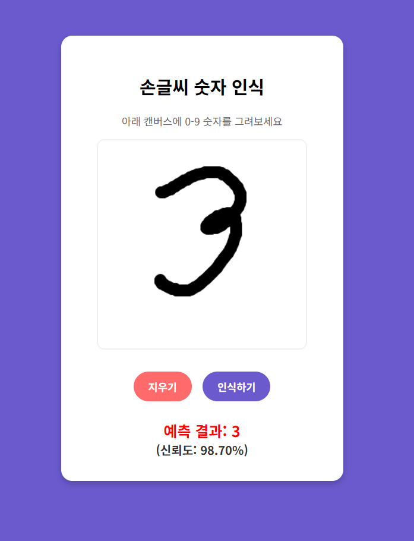

<!-- 작성일: 2026-11-25 19:43 -->
# Study-01 — 손글씨 숫자 인식 프로그램

마우스로 그린 숫자(0~9)를 인공지능이 인식해 예측 숫자와 신뢰도(%)를 보여 주는 프로그램입니다. 파이썬 데스크톱 버전과 브라우저 웹 버전, 두 가지로 만들었습니다.



## 만든 프로그램
| 버전 | 기술 | 모델 |
|---|---|---|
| 데스크톱 (`desktop_version`) | Python, Tkinter, Pillow, TensorFlow/Keras | 실행할 때마다 MNIST로 Dense 신경망(Flatten → Dense 128 → Dropout 0.2 → Dense 10)을 5 epoch 학습 |
| 웹 (`web_version`) | HTML/CSS/JS, TensorFlow.js(CDN) | 인터넷에서 사전학습 CNN(`mnist_transfer_cnn_v1`)을 불러와 사용 |

두 버전은 코드를 공유하지 않지만 화면 흐름(280×280 흰 캔버스에 그리기 → 지우기/인식 버튼 → 예측 숫자와 신뢰도)과 전처리(28×28 축소 → 흑백 반전 → 0~1 정규화)가 같습니다.

## 폴더 구조
```
Study-01/
├── CLAUDE.md                     # 공통 규칙(구조, 두 버전 공통 전처리 규칙)
├── requirements.txt              # 데스크톱 버전 파이썬 의존성
├── .gitignore                    # 가상환경(.venv) 제외
├── screenshots/screenshot.png    # 웹 버전 실행 화면
├── desktop_version/
│   ├── CLAUDE.md                 # 데스크톱 버전 전용 규칙·실행 명령
│   ├── digit_recognition.py      # MNIST 학습 + Tkinter 그리기/인식 앱
│   └── run_digit_recognition.bat # 더블클릭 실행용(Study-01/.venv 사용)
└── web_version/
    ├── CLAUDE.md                 # 웹 버전 전용 규칙
    └── index.html                # TensorFlow.js 앱(CSS/JS 인라인 단일 파일)
```

## 실행 방법
### 웹 버전
`web_version/index.html`을 브라우저에서 열면 됩니다. 모델과 TensorFlow.js를 인터넷에서 받아오므로 인터넷 연결이 필요합니다.

### 데스크톱 버전
TensorFlow 호환을 위해 Python 3.11을 씁니다. `Study-01` 폴더에서:
```powershell
py -3.11 -m venv .venv
.venv\Scripts\python.exe -m pip install -r requirements.txt
.venv\Scripts\python.exe desktop_version\digit_recognition.py
```
가상환경을 만든 뒤에는 `desktop_version/run_digit_recognition.bat`을 더블클릭해도 됩니다. 실행할 때마다 모델을 새로 학습하므로 창이 뜨기까지 몇 분 걸릴 수 있습니다. API 키는 필요 없습니다.

## 사용한 클로드 코드 기능
- **`/init`**: 기존 코드를 분석해 `CLAUDE.md`를 다시 만들었습니다.
- **`#` 메모리**: "앞으로 만드는 모든 파일은 날짜와 시간을 주석으로 표시" 규칙을 프로젝트 메모리(`CLAUDE.md`)에 추가했습니다.
- **폴더별 `CLAUDE.md`**: 루트에는 공통 규칙, `desktop_version`·`web_version`에는 각 버전 전용 규칙을 나눠 두었습니다.
- **코드 점검·수정 요청**: 폴더 구조가 바뀐 뒤 `run_digit_recognition.bat`의 가상환경 경로가 맞지 않아 클로드 코드가 고쳤습니다.
- **실행 확인**: 웹 버전을 브라우저에서 실행해 숫자 인식이 되는지 확인했습니다(위 스크린샷).
