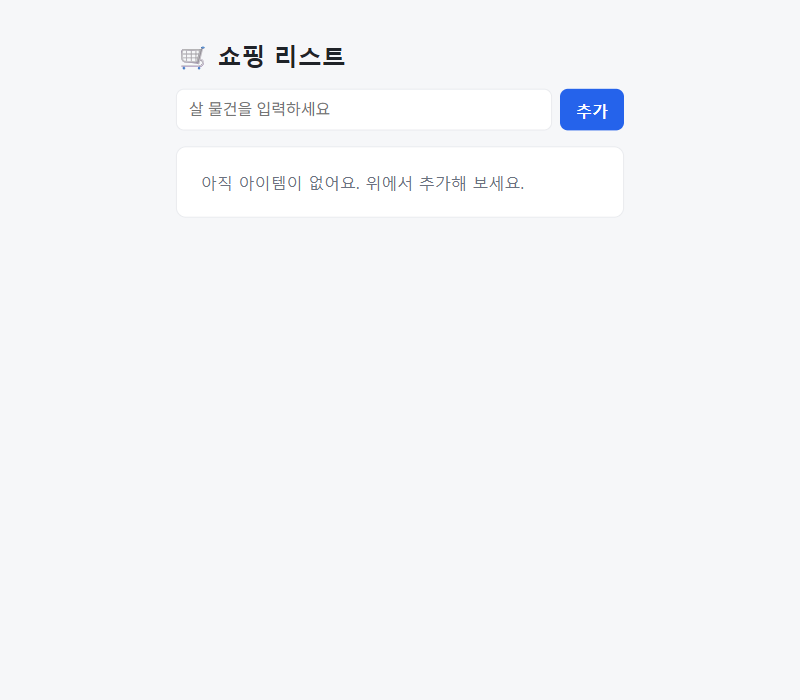
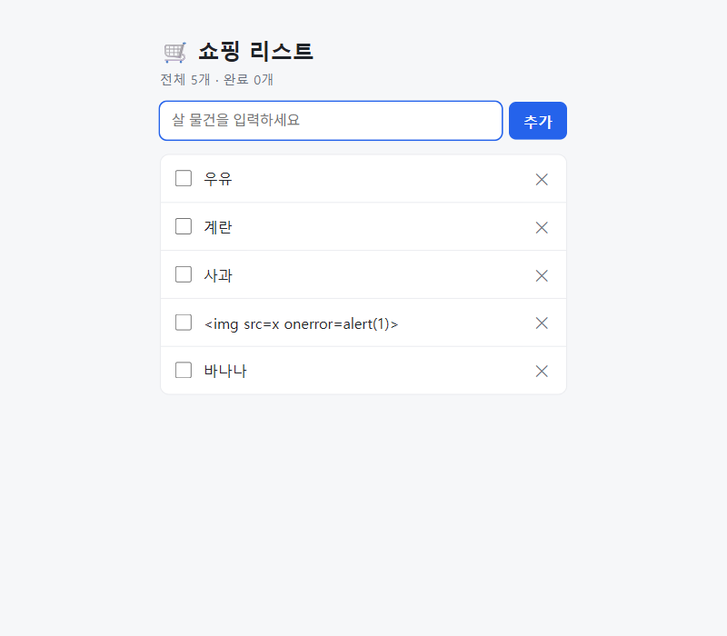
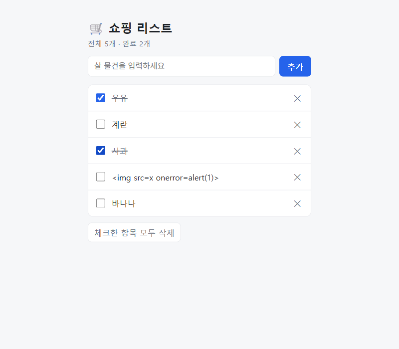
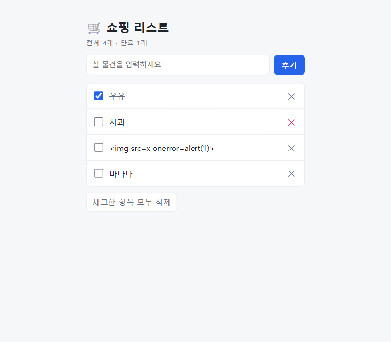
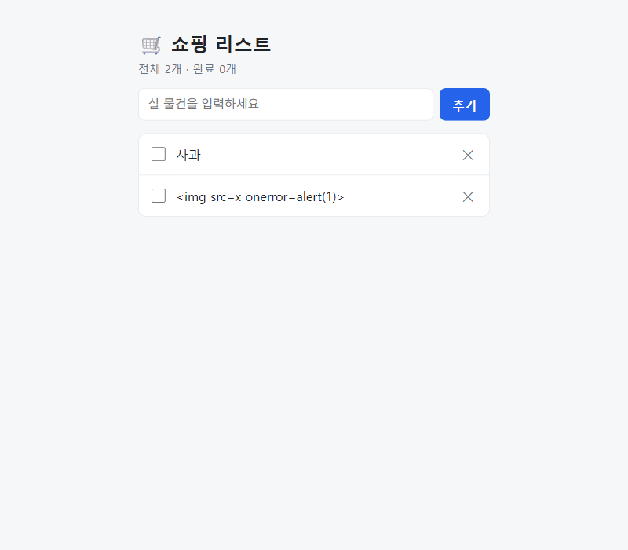
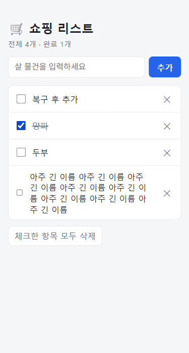
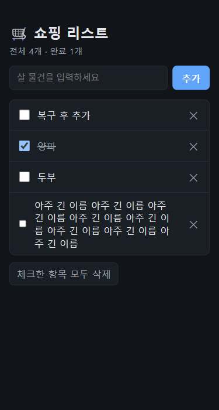

<!-- 작성일: 2026-11-25 19:56 -->
# Study-06 — MCP(Model Context Protocol) 활용

클로드 코드에 외부 도구를 연결하는 MCP 서버 5개(Sequential Thinking, Playwright, Notion, Context7, GitHub)를 설정하고, 그중 Sequential Thinking과 Playwright를 실제로 써 본 실습입니다. 결과물로 **쇼핑 리스트 앱**을 만들고 Playwright MCP로 자동 테스트했습니다.

> **솔직한 참고 사항: MCP 5개 중 2개만 실제로 사용했습니다.**
> | MCP | 상태 | 이 실습에서 한 일 |
> |---|---|---|
> | Sequential Thinking | **실제 사용** | 포트폴리오 체류 시간 2배 늘리기 방법을 6단계로 생각해 정리 |
> | Playwright | **실제 사용** | 쇼핑 리스트 앱을 브라우저에서 자동 테스트(30개 검사), 스크린샷 7장 |
> | Notion | 설정만 함(미인증) | 노션 계정을 연결하지 않아, 노션에 저장할 문서를 `notion_docs/`에 마크다운으로 대신 저장 |
> | Context7 | 설정만 함(키 미설정) | 사용하지 않음 |
> | GitHub | 설정만 함(토큰 미설정) | 사용하지 않음. 커밋·push는 일반 `git` 명령으로 함 |
>
> Notion·Context7·GitHub는 `.mcp.json`에 서버 주소와 인증 자리(환경 변수)만 넣어 두었고, 연결 방법은 [MCP_SETUP.md](MCP_SETUP.md)에 정리했습니다.

## 쇼핑 리스트 앱
`shopping-list.html` 하나로 된 웹 앱입니다(CSS/JS 인라인, 데이터는 브라우저 `localStorage`에 저장).
- 아이템 추가(Enter/버튼, 앞뒤 공백 제거, 최대 100자, 한글 입력 중 Enter 무시)
- 체크(취소선), 삭제, 체크한 항목 일괄 삭제, 전체·완료 개수 표시
- HTML 입력을 글자로만 표시(XSS 방지), 모바일 화면과 다크 모드 지원

### Playwright MCP 자동 테스트 결과
자동 검사 30개가 모두 통과했고, 스크린샷을 보고 긴 이름에서 체크박스가 줄어드는 화면 문제 1건을 찾아 고쳤습니다. 자세한 내용은 [TEST_REPORT.md](TEST_REPORT.md)에 있습니다. Playwright MCP는 `file://` 주소를 열지 못해서, 테스트하는 동안만 임시 로컬 서버를 띄웠습니다.

| 초기 화면 | 아이템 추가 | 체크 |
|---|---|---|
|  |  |  |

| 삭제 | 체크 항목 일괄 삭제 | 모바일 | 다크 모드 |
|---|---|---|---|
|  |  |  |  |

## 폴더 구조
```
Study-06/
├── CLAUDE.md                 # MCP 서버 구성과 키 관리 규칙
├── .mcp.json                 # 프로젝트 MCP 서버 5개 설정(키·토큰은 ${환경변수} 자리로만)
├── .env.example              # MCP용 환경 변수 이름 견본(CONTEXT7_API_KEY, GITHUB_PAT, 값 없음)
├── MCP_SETUP.md              # MCP별 역할, 계정 연결 방법, 보안 주의
├── shopping-list.html        # 쇼핑 리스트 앱
├── TEST_REPORT.md            # Playwright MCP 자동 테스트 보고서
├── screenshots/              # Playwright로 찍은 테스트 화면 7장
└── notion_docs/              # Notion MCP 대신 저장한 문서
    ├── 체류시간_늘리기.md            # 목표 달성 방법 구상
    └── 체류시간_늘리기_체계적구상.md  # Sequential Thinking MCP로 단계별 구상
```

## 실행 방법
### 쇼핑 리스트 앱
`shopping-list.html`을 브라우저에서 열면 됩니다. 설치할 것도, API 키도 필요 없습니다.

### MCP 서버
이 폴더에서 `claude`를 실행하면 `.mcp.json`의 서버를 쓸지 묻습니다. `/mcp`에서 연결 상태를 확인합니다.
- **Sequential Thinking, Playwright**: Node.js(`npx`)만 있으면 바로 동작합니다.
- **Context7, GitHub**: `.env.example`에 적힌 변수를 셸 환경 변수로 설정한 뒤 클로드 코드를 다시 시작합니다. 클로드 코드는 `.env` 파일을 자동으로 읽지 않습니다.
  ```powershell
  $env:CONTEXT7_API_KEY = "your_key"
  $env:GITHUB_PAT = "your_token"
  claude
  ```
- **Notion**: 키 없이 `/mcp` → `notion` → Authenticate로 브라우저에서 로그인합니다.

자세한 방법은 [MCP_SETUP.md](MCP_SETUP.md)를 보세요. 실제 키·토큰은 `.mcp.json`이나 문서에 쓰지 않습니다.

## 사용한 클로드 코드 기능
- **MCP 서버 추가·관리**: `claude mcp add`, `claude mcp list`, `/mcp`로 서버를 등록하고 상태를 확인했습니다. 팀과 공유할 수 있게 프로젝트 범위 `.mcp.json`으로 정리했습니다.
- **Sequential Thinking MCP**: 생각을 단계별로 나눠(중간 단계 수정 포함) 체계적인 계획 문서를 만들었습니다.
- **Playwright MCP**: 브라우저를 자동으로 조작해 추가·체크·삭제·저장·화면 크기·다크 모드를 검사하고 스크린샷을 찍었습니다.
- **환경 변수로 비밀값 분리**: `.mcp.json`에는 `${CONTEXT7_API_KEY}`, `${GITHUB_PAT}` 자리만 두고 실제 값은 셸 환경 변수로 넣게 했습니다.
