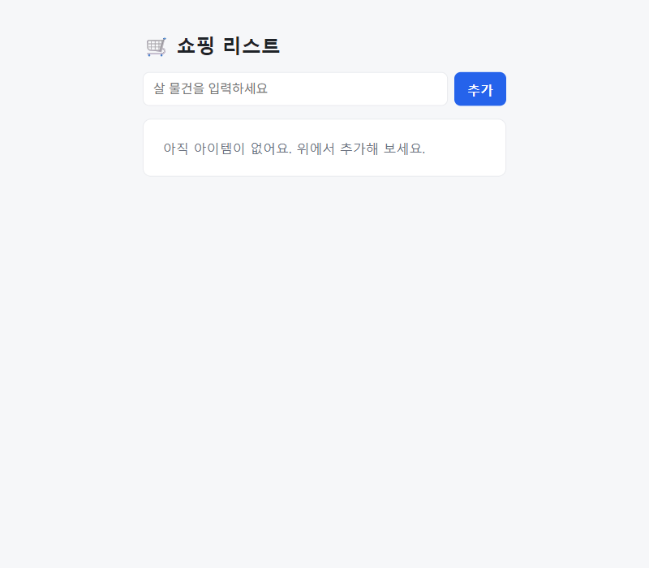
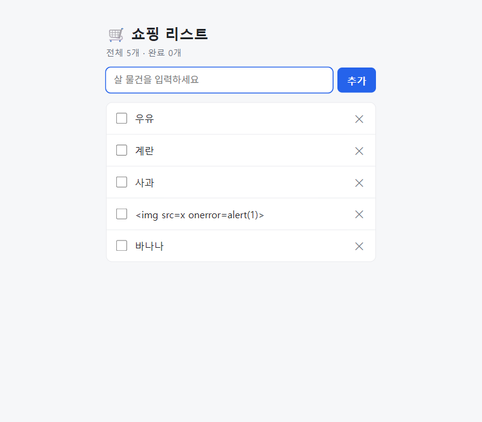
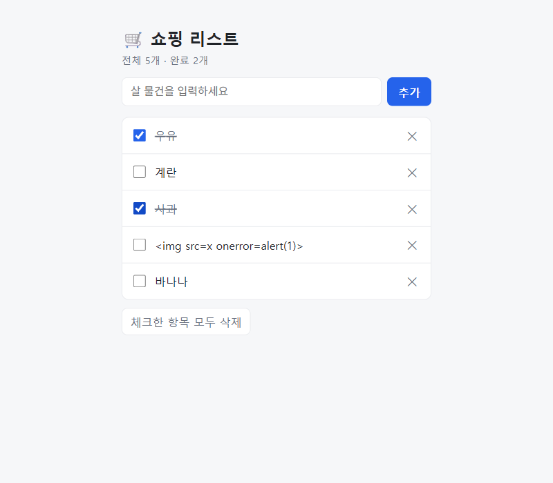
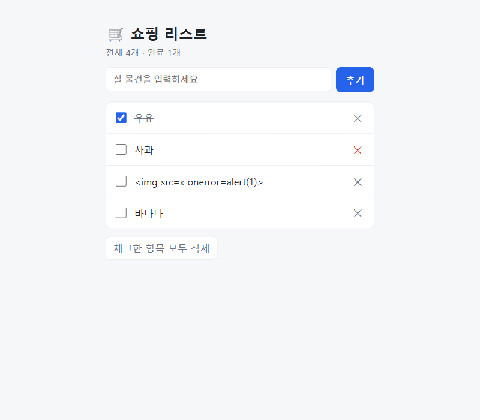
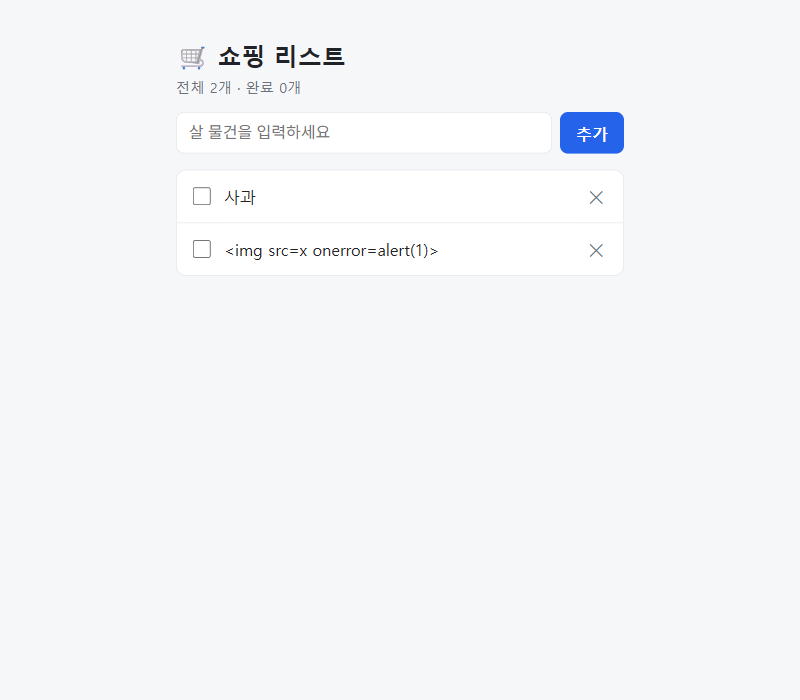
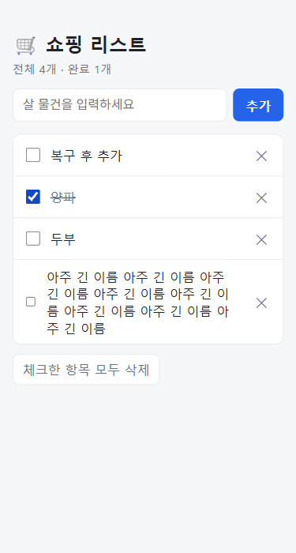
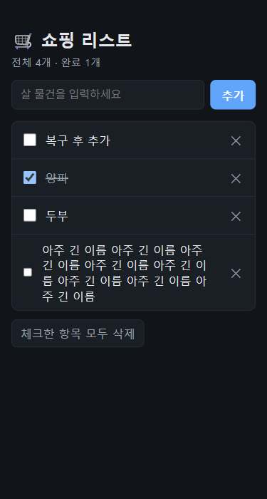

<!-- 작성일: 2026-11-25 19:55 (수정됨 2026-11-25 20:10: 체크박스 문제 수정 반영) -->
# 쇼핑 리스트 앱 자동 테스트 보고서

- **대상:** `shopping-list.html`
- **도구:** Playwright MCP (Chromium), `browser_run_code_unsafe`로 시나리오 실행
- **일시:** 2026-11-25
- **결과:** 자동 검사 **30개 모두 통과**, 스크린샷 검토에서 **화면 문제 1건 발견**

> Playwright MCP는 `file://` 주소 접근을 막습니다. 그래서 테스트하는 동안만 `127.0.0.1:5178`에 이 파일을 그대로 내보내는 임시 Node 서버를 띄웠고, 테스트가 끝난 뒤 서버와 브라우저를 모두 종료했습니다. 앱 코드는 바꾸지 않았습니다.

## 요약

| 영역 | 검사 수 | 통과 |
|---|---|---|
| 초기 상태 | 2 | 2 |
| 아이템 추가 | 10 | 10 |
| 체크 | 5 | 5 |
| 저장(localStorage) | 2 | 2 |
| 삭제 | 6 | 6 |
| 손상된 저장값 처리 | 2 | 2 |
| 화면(모바일·다크 모드)·오류 | 3 | 3 |
| **합계** | **30** | **30** |

## 상세 결과

### 1. 초기 상태
| ID | 검사 | 결과 | 확인 값 |
|---|---|---|---|
| T01 | 빈 목록 안내 문구 표시 | ✅ | "아직 아이템이 없어요. 위에서 추가해 보세요." |
| T02 | 빈 목록일 때 요약 문구와 일괄삭제 버튼 숨김 | ✅ | |

### 2. 아이템 추가
| ID | 검사 | 결과 | 확인 값 |
|---|---|---|---|
| T03 | Enter 키로 추가 | ✅ | `["우유"]` |
| T04 | "추가" 버튼으로 추가 | ✅ | `["우유","계란"]` |
| T05 | 추가 후 입력칸이 비고 포커스 유지 | ✅ | |
| T06 | 빈 값·공백만 입력하면 추가 안 됨 | ✅ | 개수 2 유지 |
| T07 | 앞뒤 공백 제거 | ✅ | `"   사과   "` → `"사과"` |
| T08 | HTML 입력을 글자로만 표시(XSS 방지) | ✅ | ``가 `&lt;img …&gt;`로 표시, `img` 요소 0개 |
| T09 | 최대 100자 제한 | ✅ | 150자 입력 → 100자 |
| T10 | 한글 조합 중 Enter로 추가되지 않음 | ✅ | 4 → 4 |
| T10b | 조합 중 Enter만 기본 동작을 막고, 일반 Enter는 막지 않음 | ✅ | `[true, false]` |
| T11 | 요약 개수 표시 | ✅ | "전체 5개 · 완료 0개" |

> T10은 가짜로 만든 키 이벤트로 시험했습니다. 이런 이벤트는 원래 폼을 제출하지 않기 때문에, 처리 코드가 없어도 T10은 통과합니다. 그래서 T10b에서 처리 코드가 `preventDefault`를 실제로 부르는지 직접 확인했습니다. 실제 IME 입력은 자동화로 재현하기 어려워 손으로 따로 확인하는 것이 좋습니다.

### 3. 체크
| ID | 검사 | 결과 | 확인 값 |
|---|---|---|---|
| T12 | 체크하면 `done` 클래스와 취소선 적용 | ✅ | `text-decoration-line: line-through` |
| T13 | 체크 후 요약 갱신 | ✅ | "전체 5개 · 완료 1개" |
| T14 | 체크한 항목이 있으면 일괄삭제 버튼 표시 | ✅ | |
| T15 | 체크박스가 아닌 이름 글자를 눌러도 체크됨 | ✅ | |
| T16 | 체크를 풀면 원래 모양과 개수로 복귀 | ✅ | "완료 1개" |

### 4. 저장 (새로고침)
| ID | 검사 | 결과 | 확인 값 |
|---|---|---|---|
| T17 | 새로고침 후 목록과 순서 유지 | ✅ | 5개 그대로 |
| T18 | 새로고침 후 체크 상태 유지 | ✅ | 우유 체크, 계란 미체크 |

### 5. 삭제
| ID | 검사 | 결과 | 확인 값 |
|---|---|---|---|
| T19 | ✕ 버튼으로 그 항목만 삭제 | ✅ | "계란"만 사라짐 |
| T20 | 삭제 버튼 접근성 이름 | ✅ | `aria-label="사과 삭제"` |
| T21 | "체크한 항목 모두 삭제" | ✅ | 체크한 우유·바나나 삭제 |
| T22 | 일괄삭제 후 버튼 숨김 | ✅ | |
| T23 | 모두 지우면 빈 목록 안내로 돌아감 | ✅ | |
| T24 | 모두 지운 뒤 새로고침해도 빈 목록 | ✅ | |

### 6. 손상된 저장값
| ID | 검사 | 결과 | 확인 값 |
|---|---|---|---|
| T25 | localStorage 값이 깨진 JSON이어도 오류 없이 빈 목록으로 시작 | ✅ | |
| T26 | 그 상태에서 추가 가능 | ✅ | `["복구 후 추가"]` |

### 7. 화면과 오류
| ID | 검사 | 결과 | 확인 값 |
|---|---|---|---|
| T27 | 모바일(375px)에서 가로로 넘치지 않음 | ✅ | 긴 이름도 줄바꿈 |
| T28 | 다크 모드 배경색 적용 | ✅ | `rgb(17, 20, 24)` |
| T29 | 테스트 중 페이지 오류 없음(추가 단계는 콘솔 오류도 확인) | ✅ | 0건 |

## 발견한 문제

### 이름이 길면 체크박스가 작아짐 (경미, 화면 문제)
- **위치:** `07_다크모드.png`, `06_모바일.png`의 마지막 줄
- **현상:** 375px 화면에서 이름이 여러 줄로 길어지면 그 줄의 체크박스가 다른 줄보다 눈에 띄게 작게 그려집니다. 자동 검사(T27)는 가로 넘침만 봤기 때문에 잡지 못했고, 스크린샷을 보고 찾았습니다.
- **원인(추정):** 체크박스가 flex 안에 있어서 공간이 모자라면 같이 줄어듭니다.
- **수정:** `li input[type=checkbox]`에 `flex-shrink: 0;`을 추가했습니다(2026-11-25). 재테스트는 하지 않았으므로 위 스크린샷은 수정 전 화면입니다.

## 스크린샷 목록
`screenshots/` 폴더에 있습니다.

| 파일 | 장면 |
|---|---|
| `01_초기화면.png` | 빈 목록 |
| `02_아이템추가.png` | 5개 추가, HTML 입력이 글자로 표시됨 |
| `03_체크.png` | 우유·사과 체크(취소선) |
| `04_삭제.png` | 계란 삭제 후 |
| `05_체크항목일괄삭제.png` | 체크 항목 일괄 삭제 후 |
| `06_모바일.png` | 375px, 긴 이름 줄바꿈 |
| `07_다크모드.png` | 375px 다크 모드 |
